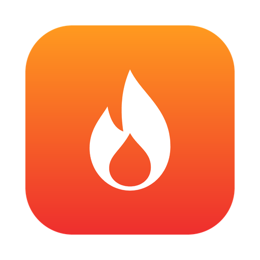

<p align="center">
  
</p>

# Fire

Fire is a desktop screen recorder and editor for polished demo videos: auto-zooms, cursor smoothing, webcam bubbles, styled backgrounds, timeline trims and speed regions, and MP4/GIF export.

> **Fire is a modified fork of [Recordly](https://github.com/webadderallorg/Recordly) by webadderall**, which itself started as a fork of OpenScreen by Siddharth Vaddem. Nearly all of the recording, editing, and export code is Recordly's. Fire changes the name, icon, bundle ID, update feed, and project file extension. It is not affiliated with or endorsed by Recordly. Licensed under AGPL-3.0, same as upstream; see [LICENSE.md](LICENSE.md).

## Build from source

Prerequisites on macOS 14+: Xcode Command Line Tools and CMake (`brew install cmake`).

```bash
git clone https://github.com/kevincorvallis/fire.git
cd fire
npm install
node node_modules/ffmpeg-static/install.js   # npm 12 blocks this install script; export needs ffmpeg
npm run dev
```

The first `npm run dev` downloads the Electron binary. The first recording asks for macOS Screen Recording permission (and microphone/camera if enabled).

Packaged builds: `npm run build:mac` (also `build:win`, `build:linux`).

## What's different from Recordly

- App name **Fire**, bundle ID `page.klee.fire`, new flame icon.
- New projects save as `.fire`. `.recordly` and `.openscreen` projects still open.
- Auto-updates check this repo's releases, not Recordly's.
- Sign-in uses the `klee-fire://` URL scheme so it doesn't collide with an installed Recordly.
- Announcements and bug reports point to this repo.
- Sign-in and cloud sharing stay off unless you set the Supabase and share-endpoint values in `.env` (see `.env.example`). Recordly's hosted services are not used.

Internal identifiers (`recordlyAuth`, `RECORDLY_*` env vars, settings keys, native helper names) keep their upstream names so upstream changes merge cleanly.

## Staying in sync with upstream

```bash
git fetch upstream
git merge upstream/main
```

Upstream docs (`CONTRIBUTING.md`, `EXTENSIONS.md`, `RELEASING.md`, `docs/`) describe Recordly and are kept as-is.

## License

AGPL-3.0, inherited from Recordly. Copyright (C) 2026 webadderall for the upstream code. Modifications are released under the same license. Per Recordly's license terms, Fire does not use the Recordly name or branding and credits Recordly in the app (sidebar and About panel) and in this repo.
